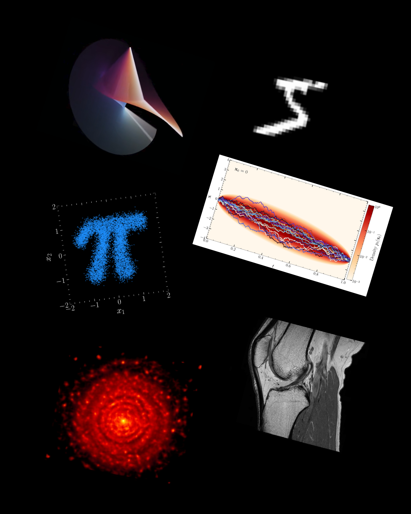

## 🎓 Introduction à l'intelligence artificielle pour lycéen(ne)s.
> Study hard what interests you the most in the most undisciplined, irreverent and original manner possible. _Richard P. Feynman_

<figure style="text-align: center;">
    
</figure>

Ce dépôt Github contient le code relatif à l'atelier en intelligence artificielle donné au lycée ESPC Saint-Joseph de Périgueux. 

### 📝 Notes de cours 
Le fichier [Notes de cours](https://github.com/mr-human-web/ai-highschool/tree/main/Notes_de_cours.pdf) contient le cours (que je suis actuellement en train d'écrire) portant sur trois axes:
- La programmation en Python (matériel complémentaire à ce dépôt Github)
- Les mathématiques (calcul différentiel, intégral, statistiques) à connaître pour faire de l'apprentissage profond. 
- L'apprentissage machine et l'apprentissage profond.

### 💻 Tutoriels et exercices de programmation en Python
Le dossier [tutorials](https://github.com/mr-human-web/ai-highschool/tree/main/tutorials) contient des notebooks pour apprendre pas à pas la programmation en Python. À chaque tutoriel est associé un notebook contenant une série d'exercices pour mettre en pratique les connaissances théoriques. Ces notebooks sont dans le dossier [exercises](https://github.com/mr-human-web/ai-highschool/tree/main/tutorials). 

Il existe un nombre considérable de cours pour apprendre la programmation en Python sur YouTube et sur Github. Il en existe beaucoup donc voici une liste de certains que j'ai trouvé sympa et que je vous conseille 
- [Introduction à Python de l'Université de Waterloo](https://cscircles.cemc.uwaterloo.ca/dev/fr/)
- [Introduction à Python de l'Université de Bordeaux](https://cgaspard3333.github.io/intro-python/groupe-b/index.html)
- [Tutoriel complet de Python (qui peut être un peu indigeste)](https://docs.python.org/fr/3.11/tutorial/index.html) 

### ⚛️ Mini-Projets de modélisation numérique de système physique
Le dossier [mini_projects](https://github.com/mr-human-web/ai-highschool/tree/main/mini_projects) contient des notebooks guides pour réaliser des projets de modélisation numérique (en Python) de système physique allant du spirographe en passant par le double pendule et le problème à trois corps pour finir par les attracteurs. 

### 🦾 Projets d'apprentissage profond et machine
A venir...

(Climate Downscaling with stochastic interpolants ? Bayesian inference on simulations for MRI with diffusion models ? )
